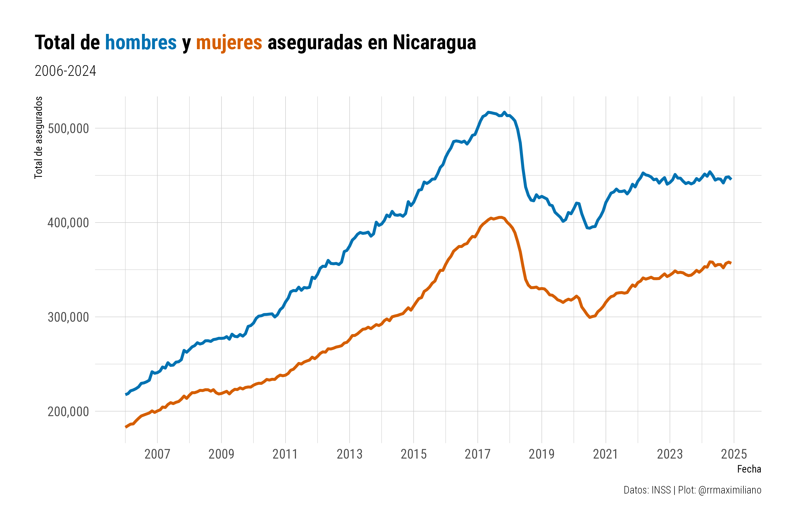
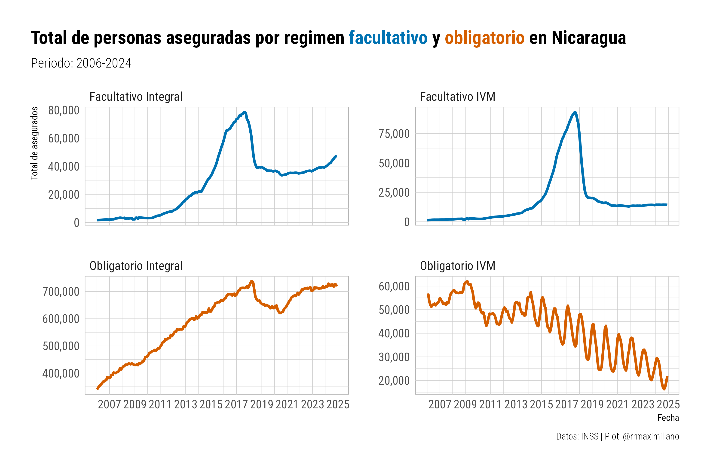
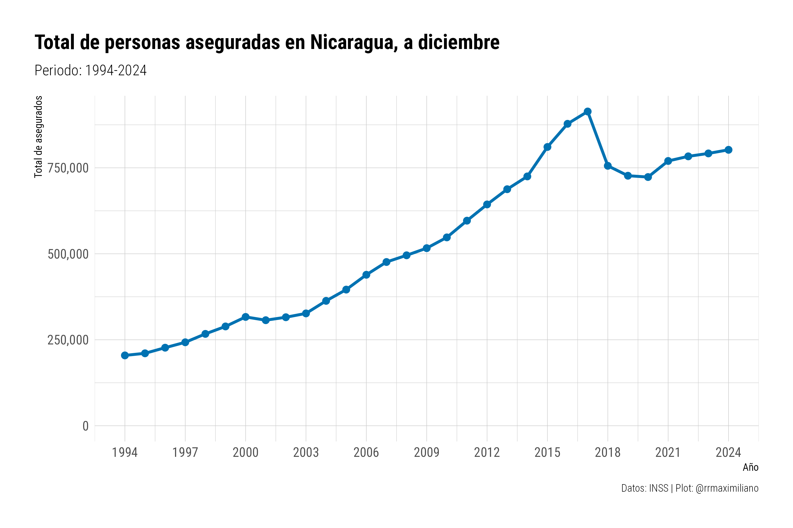
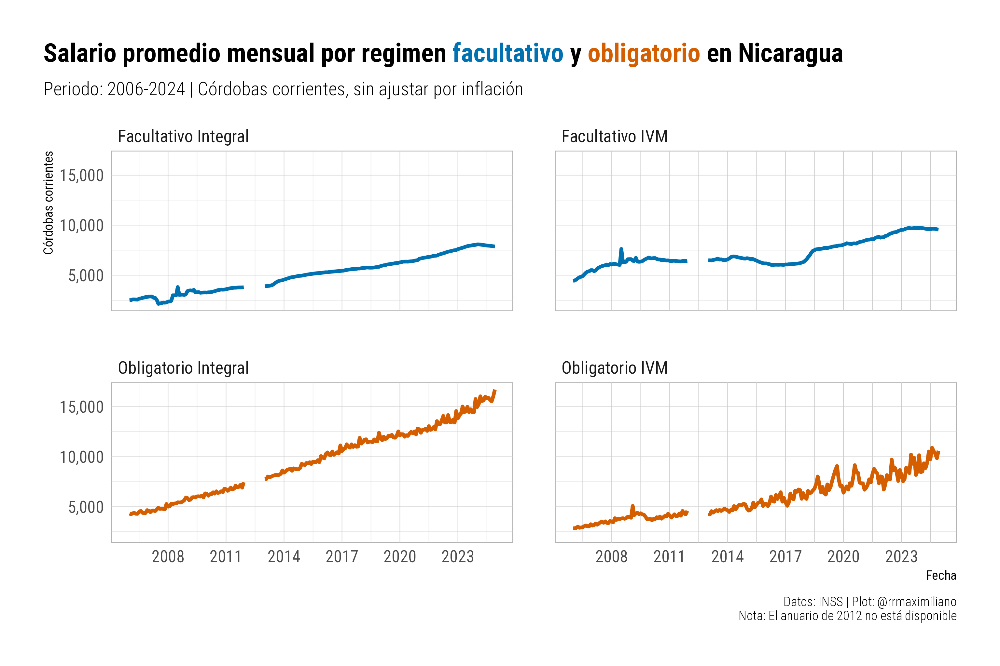
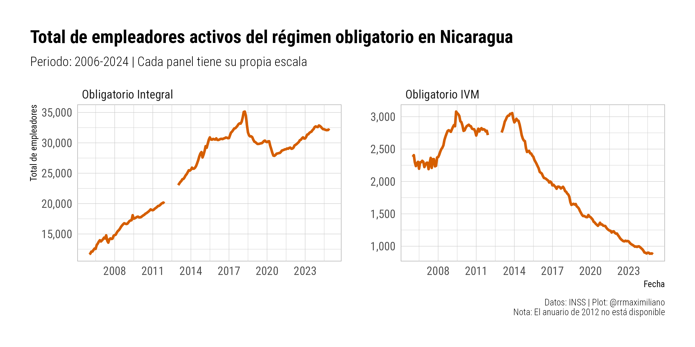
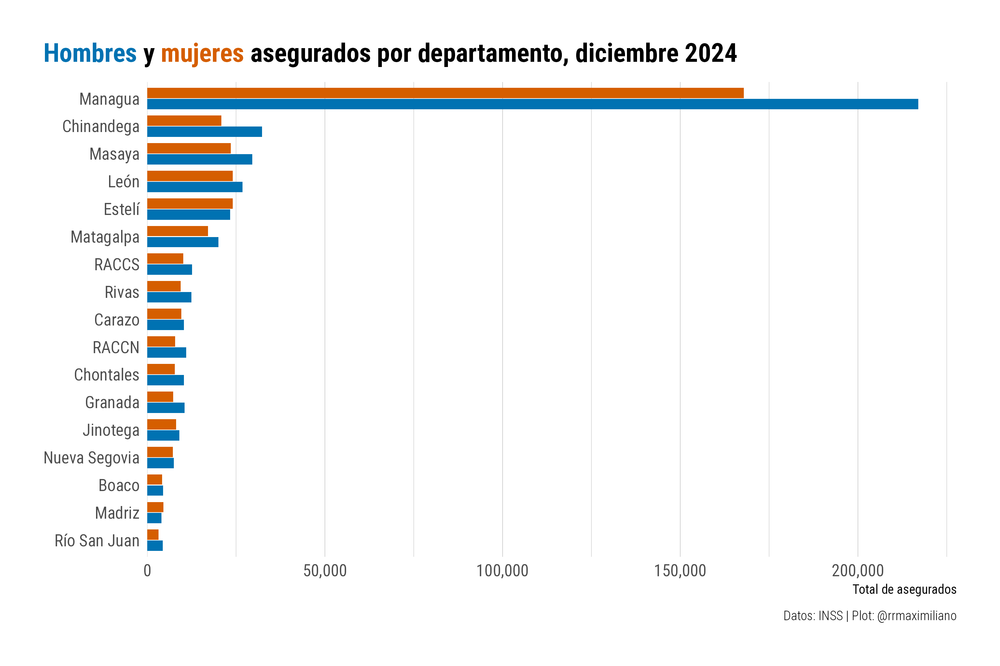

<!-- README.md is generated from README.Rmd. Please edit that file -->

```{r, include = FALSE}
knitr::opts_chunk$set(
  collapse = TRUE,
  comment = "#>",
  fig.path = "man/figures/README-",
  out.width = "100%"
)
```

# Estadísticas del Instituto de Seguridad Social de Nicaragua

```{r, include = FALSE}
library(tidyverse)

# Read data ---------------------------------------------------------------
project <- "."
data    <- file.path(project, "data")

inss <- read_rds(file.path(data, "inss_gender.rds"))
inss_reg <- read_rds(file.path(data, "inss_regimen.rds"))
inss_reg_dic <- read_rds(file.path(data, "inss_regimen_diciembre.rds"))
inss_salarios <- read_rds(file.path(data, "inss_salarios.rds"))
inss_empleadores <- read_rds(file.path(data, "inss_empleadores.rds"))
inss_departamento <- read_rds(file.path(data, "inss_departamento.rds"))
```

Este repositorio contiene datos extraídos de los reportes de los anuarios estadísticos del Instituto de Seguridad Social de Nicaragua. Los datos se encuentran en la subcarpeta `data` en formato `csv` y `rds`.

| Base | Contenido | Frecuencia | Periodo |
|---|---|---|---|
| `inss_gender` | Asegurados activos por sexo y grupo de edad | mensual | 2006-2024 |
| `inss_regimen` | Asegurados activos por régimen | mensual | 2006-2024 |
| `inss_regimen_diciembre` | Asegurados activos por régimen, a diciembre | anual | 1994-2024 |
| `inss_salarios` | Salarios devengados y salario promedio por régimen | mensual | 2006-2024, sin 2012 |
| `inss_empleadores` | Empleadores activos del Régimen Obligatorio | mensual | 2006-2024, sin 2012 |
| `inss_departamento` | Asegurados activos por departamento y sexo, a diciembre | anual | 2006-2024, sin 2012 |

## Por género

Las variables en esta base son: 

* `year`: año
* `gender`: género 
* `edad`: grupo de edad
* `mes`: mes
* `asegurados`: cantidad de asegurados activos

```{r}
inss
```

```{r, echo = FALSE, fig.alt = "Total mensual de hombres y mujeres asegurados en Nicaragua, 2006-2024"}

```

## Por régimen

Las variables en esta base son: 

* `year`: año
* `month`: mes 
* `regimen`: tipo de régimen (i.e., facultativo y obligatorio)
* `asegurados`: cantidad de asegurados activos

```{r}
inss_reg
```

```{r, echo = FALSE, fig.alt = "Asegurados mensuales por régimen facultativo y obligatorio, 2006-2024"}

```

## Por régimen, a diciembre (1994-2024)

Las variables en esta base son: 

* `year`: año
* `regimen`: tipo de régimen
* `asegurados`: cantidad de asegurados activos en diciembre

Los años 1994-2005 provienen del cuadro histórico "Asegurados activos por régimen de afiliación, Diciembre 1994 - 20XX", que aparece en los anuarios de 2006 a 2013 con las mismas cifras en todas las ediciones. Los años 2006-2024 son el mes de diciembre de `inss_regimen`.

```{r}
inss_reg_dic
```

```{r, echo = FALSE, fig.alt = "Total de asegurados en diciembre de cada año, 1994-2024"}

```

## Salarios

Las variables en esta base son: 

* `year`: año
* `month`: mes 
* `regimen`: tipo de régimen
* `salarios`: salarios devengados en el mes, en córdobas corrientes
* `salario_promedio`: salario promedio devengado publicado por el INSS, en córdobas corrientes

El salario promedio publicado es igual a `salarios` entre los asegurados del mismo régimen y mes en `inss_regimen`, con diferencias de redondeo menores a 0.06 córdobas. El anuario de 2014 publica los salarios en miles de córdobas; aquí están convertidos a córdobas.

```{r}
inss_salarios
```

```{r, echo = FALSE, fig.alt = "Salario promedio mensual por régimen en córdobas corrientes, 2006-2024 sin 2012"}

```

## Empleadores

Las variables en esta base son: 

* `year`: año
* `month`: mes 
* `regimen`: Obligatorio Integral u Obligatorio IVM (el Seguro Facultativo no tiene empleadores)
* `empleadores`: cantidad de empleadores activos

```{r}
inss_empleadores
```

```{r, echo = FALSE, fig.alt = "Empleadores activos mensuales del régimen obligatorio, 2006-2024 sin 2012"}

```

## Por departamento

Las variables en esta base son: 

* `year`: año
* `departamento`: departamento, con nombres armonizados (RAAN y RAAS aparecen como RACCN y RACCS)
* `departamento_anuario`: nombre como aparece en el anuario. En 2006 y 2007 Managua aparece dividida en sucursales del INSS; `departamento` las agrupa como Managua
* `gender`: género
* `asegurados`: cantidad de asegurados activos en diciembre

```{r}
inss_departamento
```

```{r, echo = FALSE, fig.alt = "Hombres y mujeres asegurados por departamento en diciembre de 2024"}

```


## Fuentes y replicación

Las bases por género y por régimen cubren 2006-2024. Los datos de 2006 y 2008-2018 se digitaron a mano en `data/raw/*.xlsx`. Los de 2007 y 2019-2024 se extraen de los anuarios en PDF con `script/00_extract.R`, que descarga cada anuario de las copias del Wayback Machine (el sitio del INSS bloquea descargas automáticas) y lee los cuadros "Asegurados activos por mes, según sexo y grupo de edad" y "Asegurados activos del Régimen Obligatorio y Seguro Facultativo, por mes". Para los años en que ambas fuentes existen, la extracción coincide con los datos digitados en todas las celdas. El anuario de 2012 archivado está incompleto, así que ese año proviene solo de los datos digitados, y falta en las bases de salarios, empleadores y departamentos, que no tienen datos digitados.

Las demás bases se extraen solo de los anuarios. En el anuario de 2016, los cuadros de salarios por mes y de asegurados por departamento son imágenes, así que se leen con OCR (tesseract). `script/00_extract.R` verifica cada cuadro contra sus propios totales y contra los otros cuadros que reportan la misma cifra, e imprime las filas que no cuadran. Las únicas diferencias que quedan son errores en los anuarios, y las cifras se dejan como se publicaron:

* Empleadores, marzo de 2008: 15,222 + 2,458 suman 17,680, pero el anuario publica un total de 17,580.
* Departamentos, 2008: los totales de hombres (218,294) y mujeres (277,291) están invertidos respecto al cuadro de asegurados por sexo y edad (277,291 hombres y 218,294 mujeres en diciembre).
* Departamentos, 2006: los totales por sexo (216,598 hombres y 222,404 mujeres) no coinciden con el cuadro por sexo y edad (240,241 y 198,761). El total general, 439,002, sí coincide.

Para reproducir: `script/00_extract.R` (requiere `pdftotext` y `pdftoppm` de poppler, `tesseract` y el paquete `png` de R), luego `script/01_cleaning.R` y `script/02_plot.R`.

## Comentarios y sugerencias

Para realizar comentarios o sugerencias sobre la base de datos puedes abrir un issue en este repositorio: [https://github.com/RRMaximiliano/inss_nicaragua/issues](https://github.com/RRMaximiliano/inss_nicaragua/issues)